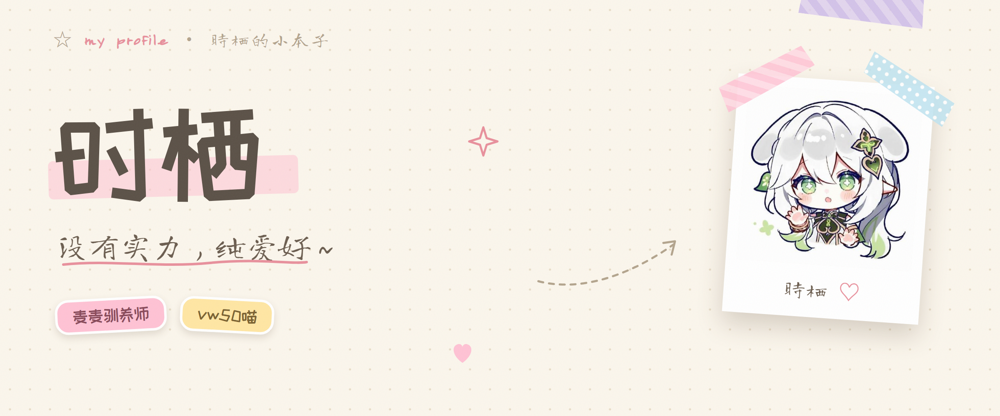

<a href="https://github.com/octmicy">
<picture>
<source media="(prefers-color-scheme: dark)" srcset="https://readme-typing-svg.demolab.com?font=Long+Cang&size=26&duration=3200&pause=900&color=FFC2D4&center=true&vCenter=true&width=620&lines=%E6%AC%A2%E8%BF%8E%E7%BF%BB%E5%BC%80%E6%97%B6%E6%A0%96%E7%9A%84%E5%B0%8F%E6%9C%AC%E5%AD%90%20%E2%9C%A6;%E6%B2%A1%E6%9C%89%E5%AE%9E%E5%8A%9B%EF%BC%8C%E7%BA%AF%E7%88%B1%E5%A5%BD%20%28%E2%97%95%E2%80%BF%E2%97%95%29">

</picture>
</a>

> ✿ 养麦麦（MaiBot）· 做校园 App · 纳西妲单推 — 把脑洞慢慢变成能跑的东西 (◕‿◕)

---

## ✿ 精选项目

<a href="https://github.com/octmicy/Mai_life">
<picture>
<source media="(prefers-color-scheme: dark)" srcset="https://github-readme-stats-rickstaa.vercel.app/api/pin/?username=octmicy&repo=Mai_life&bg_color=2a2535&title_color=ffc2d4&text_color=cbbfe6&border_color=403a52&icon_color=b9a7e0">

</picture>
</a>
<a href="https://github.com/octmicy/OriCampus">
<picture>
<source media="(prefers-color-scheme: dark)" srcset="https://github-readme-stats-rickstaa.vercel.app/api/pin/?username=octmicy&repo=OriCampus&bg_color=2a2535&title_color=ffc2d4&text_color=cbbfe6&border_color=403a52&icon_color=b9a7e0">

</picture>
</a>

## ✿ 观察记录

<picture>
<source media="(prefers-color-scheme: dark)" srcset="https://github-readme-stats-rickstaa.vercel.app/api?username=octmicy&show_icons=true&include_all_commits=true&count_private=true&bg_color=2a2535&title_color=ffc2d4&text_color=cbbfe6&icon_color=b9a7e0&border_color=403a52">

</picture>
<picture>
<source media="(prefers-color-scheme: dark)" srcset="https://github-readme-stats-rickstaa.vercel.app/api/top-langs/?username=octmicy&layout=compact&langs_count=6&bg_color=2a2535&title_color=ffc2d4&text_color=cbbfe6&border_color=403a52&hide_border=true">

</picture>

## ✿ 小玩具

<picture>
<source media="(prefers-color-scheme: dark)" srcset="https://raw.githubusercontent.com/octmicy/octmicy/output/github-snake-dark.svg">

</picture>

---

✿ ♡ ✿ &nbsp; 时栖 (◕‿◕)ﾉ

